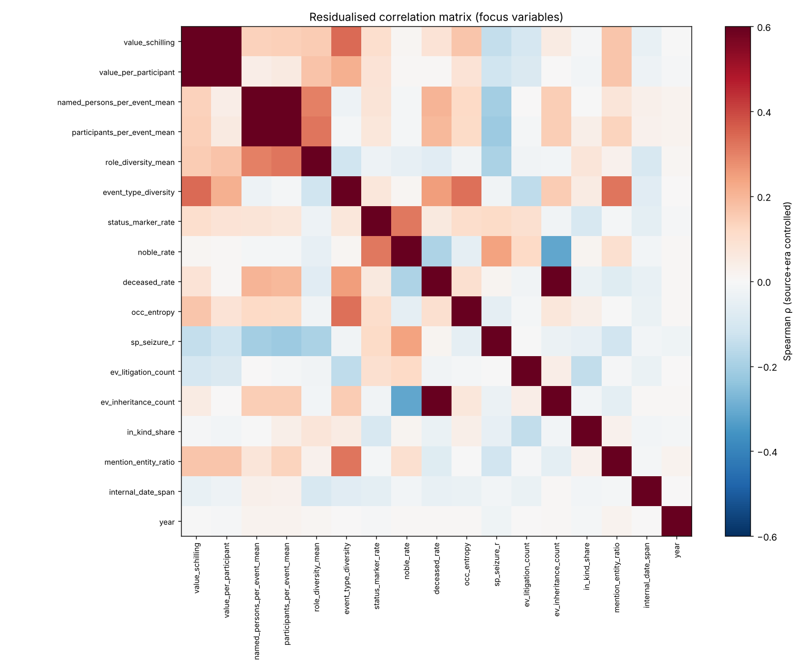
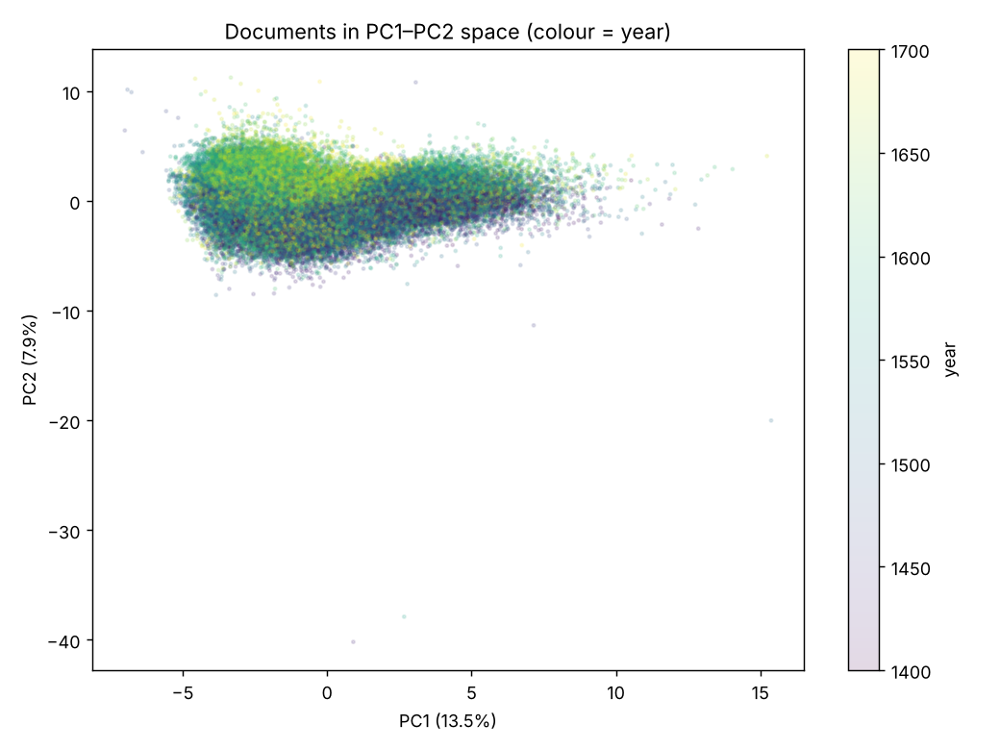

# HGB feature correlation & pattern analysis

Documents: **75,447**, raw columns: 154

## 1. Comparability transforms applied

- 53 numeric features; 10 log1p-transformed; all z-scored.
- Residualised against **source (165 archives) + 25y time_bin** to net out provenance/era confounds.

## 2. Strongest correlations (Spearman)

### Raw (top 18)

| variable A | variable B | ρ |
|---|---|---|
| sp_title_r | status_marker_rate | +0.997 |
| ev_seizure_count | sp_seizure_r | +0.973 |
| participants_per_event_mean | named_persons_per_event_mean | +0.964 |
| value_per_participant | value_schilling | +0.946 |
| ev_litigation_count | sp_litigation_r | +0.944 |
| event_type_diversity | n_events | +0.934 |
| conf_std | conf_mean | -0.916 |
| sp_dead_r | deceased_rate | +0.904 |
| occ_entropy | n_occ_distinct | +0.901 |
| ev_ownership_count | sp_owner_r | +0.893 |
| sp_occ_r | n_occ_distinct | +0.808 |
| n_events | n_tokens | +0.734 |
| sp_title_r | master_rate | +0.698 |
| master_rate | status_marker_rate | +0.696 |
| ev_property-purchase_count | price_per_property | +0.680 |
| event_type_diversity | n_tokens | +0.677 |
| distinct_entities | n_events | +0.655 |
| ev_inheritance_count | deceased_rate | +0.636 |

### After source+era control (top 18) — associations that survive confounds

| variable A | variable B | ρ_resid |
|---|---|---|
| sp_title_r | status_marker_rate | +0.980 |
| ev_litigation_count | sp_litigation_r | +0.969 |
| participants_per_event_mean | named_persons_per_event_mean | +0.964 |
| value_per_participant | value_schilling | +0.946 |
| ev_seizure_count | sp_seizure_r | +0.935 |
| occ_entropy | n_occ_distinct | +0.903 |
| event_type_diversity | n_events | +0.880 |
| conf_std | conf_mean | -0.878 |
| sp_dead_r | deceased_rate | +0.878 |
| ev_ownership_count | sp_owner_r | +0.846 |
| sp_occ_r | n_occ_distinct | +0.763 |
| sp_title_r | master_rate | +0.729 |
| master_rate | status_marker_rate | +0.726 |
| ev_inheritance_count | deceased_rate | +0.689 |
| n_events | n_tokens | +0.648 |
| event_type_diversity | n_tokens | +0.592 |
| distinct_entities | n_events | +0.583 |
| sp_occ_r | occ_entropy | +0.581 |

## 3. PCA — which variables co-move

Explained variance: PC1=13.5%, PC2=7.9%, PC3=6.3%, PC4=5.1%, PC5=4.7%  (cumulative 5 = 37.6%)

**PC1** top loadings: event_type_diversity (+0.32), n_events (+0.31), distinct_entities (+0.30), n_tokens (+0.28), value_schilling (+0.27), n_occ_distinct (+0.26), occ_entropy (+0.25), price_per_property (+0.25)
**PC2** top loadings: participants_per_event_mean (+0.32), named_persons_per_event_mean (+0.31), sp_fac_r (-0.31), conf_mean (+0.29), conf_std (-0.26), sp_loc_r (-0.26), sp_owner_r (-0.25), role_diversity_mean (+0.22)
**PC3** top loadings: currency_count (+0.32), sp_per_r (-0.30), named_persons_per_event_mean (-0.27), sp_money_r (+0.27), participants_per_event_mean (-0.24), ev_due-obligation_count (+0.23), sp_occ_r (-0.22), sp_title_r (-0.22)

## 4. Emergent document types (KMeans, k=6 on PCA scores)

|   cluster |   value_schilling |   named_persons_per_event_mean |   event_type_diversity |   status_marker_rate |   deceased_rate |   sp_seizure_r |   ev_inheritance_count |   ev_litigation_count |   in_kind_share |   year |   n_docs | top_event_combo                                               | top_source     |
|----------:|------------------:|-------------------------------:|-----------------------:|---------------------:|----------------:|---------------:|-----------------------:|----------------------:|----------------:|-------:|---------:|:--------------------------------------------------------------|:---------------|
|         0 |              23   |                           1    |                      2 |                    0 |            0    |              0 |                      0 |                     0 |               0 |   1590 |    16927 | due-payment                                                   | St. Alban      |
|         1 |              30   |                           1.25 |                      4 |                    0 |            0.33 |              0 |                      1 |                     0 |               0 |   1618 |     7884 | due-payment|inheritance                                       | Gerichtsarchiv |
|         2 |              30   |                           0.62 |                      3 |                    0 |            0    |              0 |                      0 |                     0 |               0 |   1516 |    20201 | due-payment|ownership|topological                             | Gerichtsarchiv |
|         3 |            2070.5 |                           1.11 |                      6 |                    0 |            0    |              0 |                      0 |                     0 |               0 |   1506 |    19579 | due-obligation|family|ownership|property-purchase|topological | Gerichtsarchiv |
|         4 |              40   |                           1    |                      3 |                    0 |            0    |              0 |                      0 |                     1 |               0 |   1584 |     6201 | litigation|ownership|topological                              | Gerichtsarchiv |
|         5 |             100   |                           1    |                      3 |                    1 |            0    |              0 |                      0 |                     0 |               0 |   1607 |     4655 | property-purchase|topological                                 | Gerichtsarchiv |

## 5. Event-type co-occurrence (PMI & lift)

### Most positively associated event pairs (top lift)

| event_a           | event_b           |   p_joint |   lift |   pmi |   n_docs |
|:------------------|:------------------|----------:|-------:|------:|---------:|
| pledge            | debt              |     0.002 | 31.921 | 4.996 |      156 |
| civic-affiliation | rent-purchase     |     0.019 |  4.015 | 2.005 |     1399 |
| rent-purchase     | redemption        |     0.007 |  3.11  | 1.637 |      515 |
| civic-affiliation | pledge            |     0.002 |  2.982 | 1.576 |      115 |
| family            | bequest           |     0.012 |  2.902 | 1.537 |      909 |
| civic-affiliation | redemption        |     0.007 |  2.862 | 1.517 |      558 |
| civic-affiliation | transfer          |     0.001 |  2.645 | 1.403 |      103 |
| civic-affiliation | debt              |     0.002 |  2.481 | 1.311 |      129 |
| redemption        | debt              |     0.001 |  2.429 | 1.28  |       60 |
| property-purchase | civic-affiliation |     0.042 |  2.412 | 1.27  |     3160 |
| family            | rent-purchase     |     0.048 |  2.401 | 1.263 |     3655 |
| inheritance       | membership        |     0.011 |  2.335 | 1.223 |      856 |

### Most *under*-associated (lowest lift, avoided combinations)

| event_a           | event_b           |   p_joint |   lift |    pmi |   n_docs |
|:------------------|:------------------|----------:|-------:|-------:|---------:|
| due-payment       | seizure           |     0.001 |  0.032 | -4.975 |      106 |
| due-payment       | property-purchase |     0.005 |  0.069 | -3.853 |      408 |
| due-obligation    | litigation        |     0.002 |  0.085 | -3.556 |      155 |
| seizure           | rent-purchase     |     0.001 |  0.121 | -3.05  |       76 |
| property-purchase | litigation        |     0.002 |  0.163 | -2.618 |      152 |
| due-payment       | civic-affiliation |     0.005 |  0.205 | -2.288 |      378 |
| property-purchase | rent-purchase     |     0.003 |  0.227 | -2.142 |      252 |
| inheritance       | litigation        |     0.001 |  0.232 | -2.11  |       87 |

### Lift of top pairs across 25-year bins (pattern stability)

| pair | 1400 | 1425 | 1450 | 1475 | 1500 | 1525 | 1550 | 1575 | 1600 | 1625 | 1650 | 1675 | 1700 |
|---|---|---|---|---|---|---|---|---|---|---|---|---|---|
| pledge×debt | 16.14 | 21.86 | 12.83 | 18.96 | 36.45 | 53.08 | 51.43 | 52.12 | 55.84 | 27.53 | 39.14 | 59.77 | · |
| civic-affiliation×rent-purchase | 1.58 | 2.99 | 3.38 | 2.59 | 2.19 | 2.81 | 5.89 | 12.51 | 16.59 | 17.59 | 5.96 | 20.82 | · |
| rent-purchase×redemption | 1.66 | 2.76 | 2.18 | 1.48 | 1.83 | 1.77 | 6.46 | 9.89 | 12.15 | 14.63 | · | 3.38 | · |
| civic-affiliation×pledge | 0.74 | 1.41 | 0.68 | 2.15 | 2.31 | 2.72 | 5.54 | 6.42 | 14.31 | 9.64 | 15.11 | 22.56 | · |

## 6. Categorical associations

### Cramér's V among categoricals

|                 |   source |   time_bin |   language |   dossiertype |   cluster |   gov_org_present |
|:----------------|---------:|-----------:|-----------:|--------------:|----------:|------------------:|
| source          |    1     |      0.275 |      0.291 |         0.11  |     0.339 |             0.415 |
| time_bin        |    0.275 |      1     |      0.115 |         0.04  |     0.22  |             0.269 |
| language        |    0.291 |      0.115 |      1     |         0.102 |     0.08  |             0.06  |
| dossiertype     |    0.11  |      0.04  |      0.102 |         1     |     0.061 |             0.035 |
| cluster         |    0.339 |      0.22  |      0.08  |         0.061 |     1     |             0.504 |
| gov_org_present |    0.415 |      0.269 |      0.06  |         0.035 |     0.504 |             1     |

### Correlation ratio η (categorical → numeric); higher = category explains more variance

|          |   value_schilling |   named_persons_per_event_mean |   status_marker_rate |   in_kind_share |   event_type_diversity |   sp_seizure_r |
|:---------|------------------:|-------------------------------:|---------------------:|----------------:|-----------------------:|---------------:|
| source   |             0.707 |                          0.349 |                0.16  |           0.251 |                  0.591 |          0.372 |
| time_bin |             0.16  |                          0.242 |                0.128 |           0.088 |                  0.246 |          0.25  |
| cluster  |             0.708 |                          0.483 |                0.774 |           0.113 |                  0.739 |          0.291 |

## 7. Spatial autocorrelation (Moran's I, k-nearest=8)

Geo-located unique dossiers: 3,694

| variable | Moran's I |
|---|---|
| value_schilling | +0.117 |
| status_marker_rate | +0.042 |
| noble_rate | +0.062 |
| sp_seizure_r | +0.024 |
| named_persons_per_event_mean | +0.048 |
| in_kind_share | +0.094 |
| ev_litigation_count | +0.033 |

(I≈0 random; I>0 spatially clustered; I<0 dispersed)
